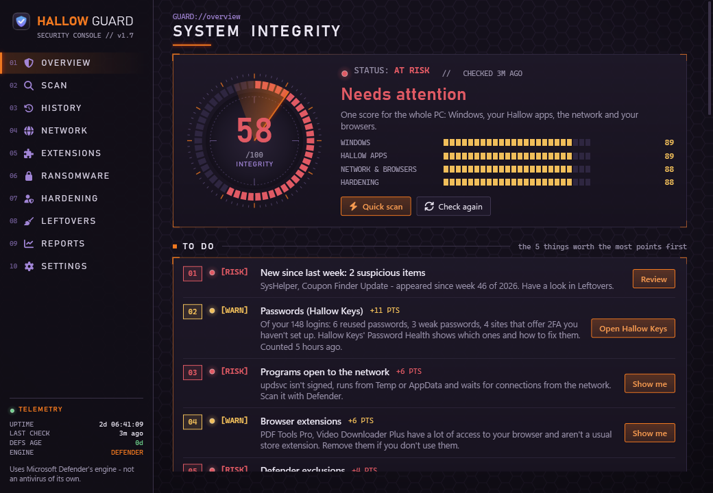
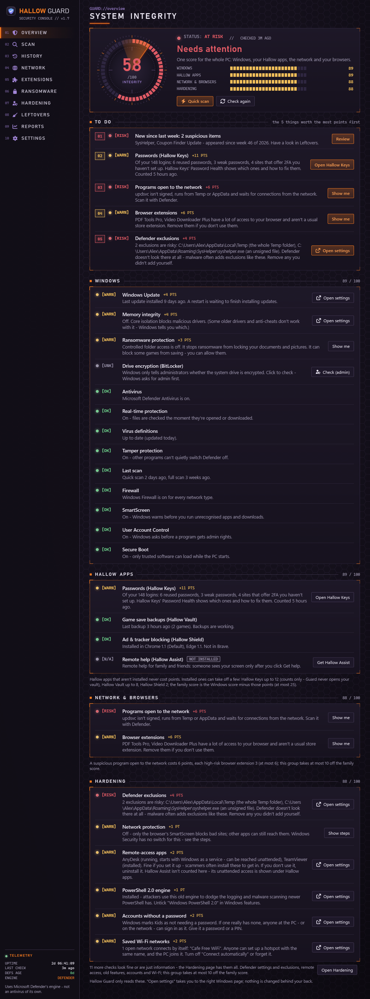
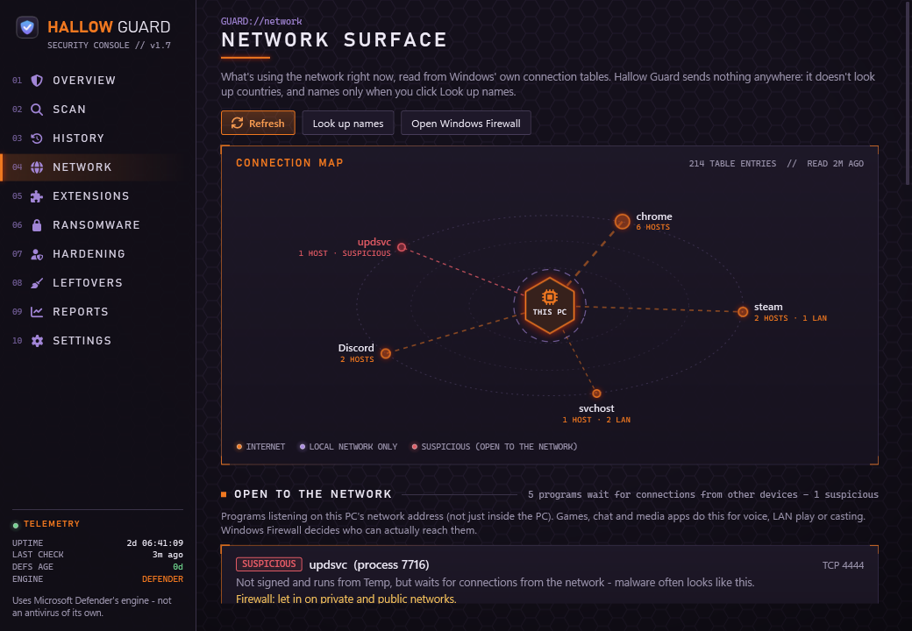
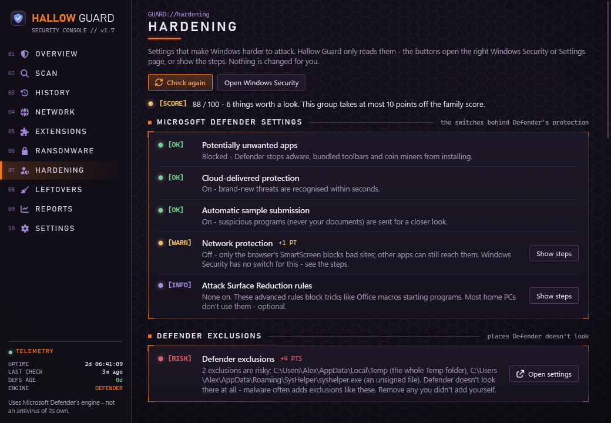
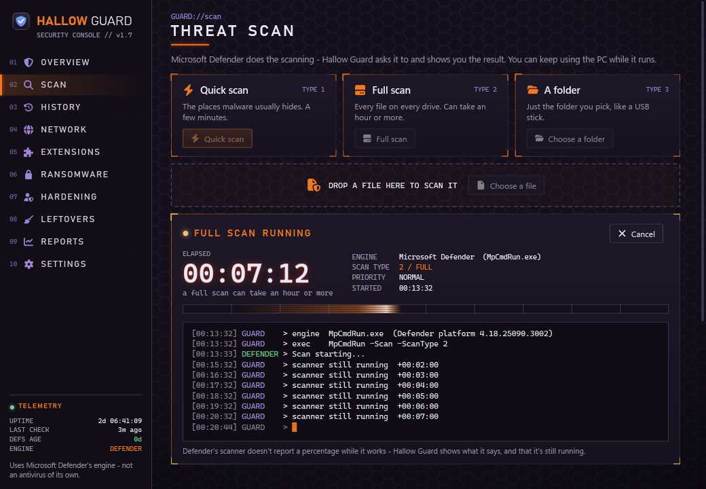
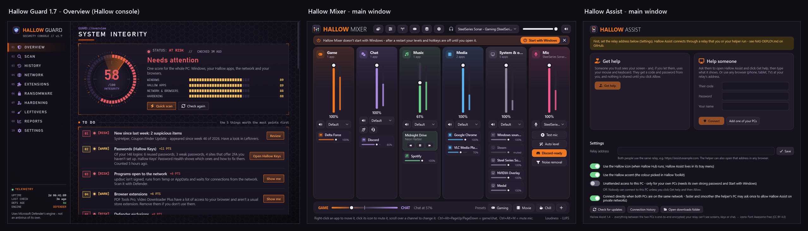
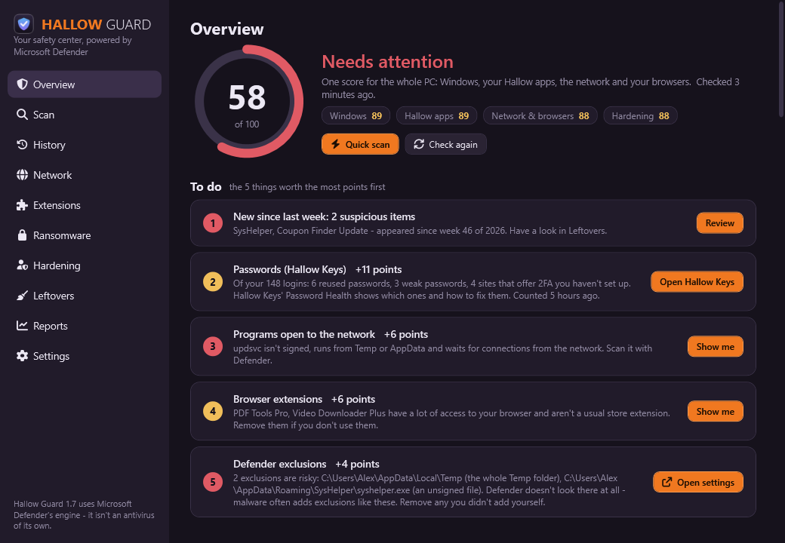
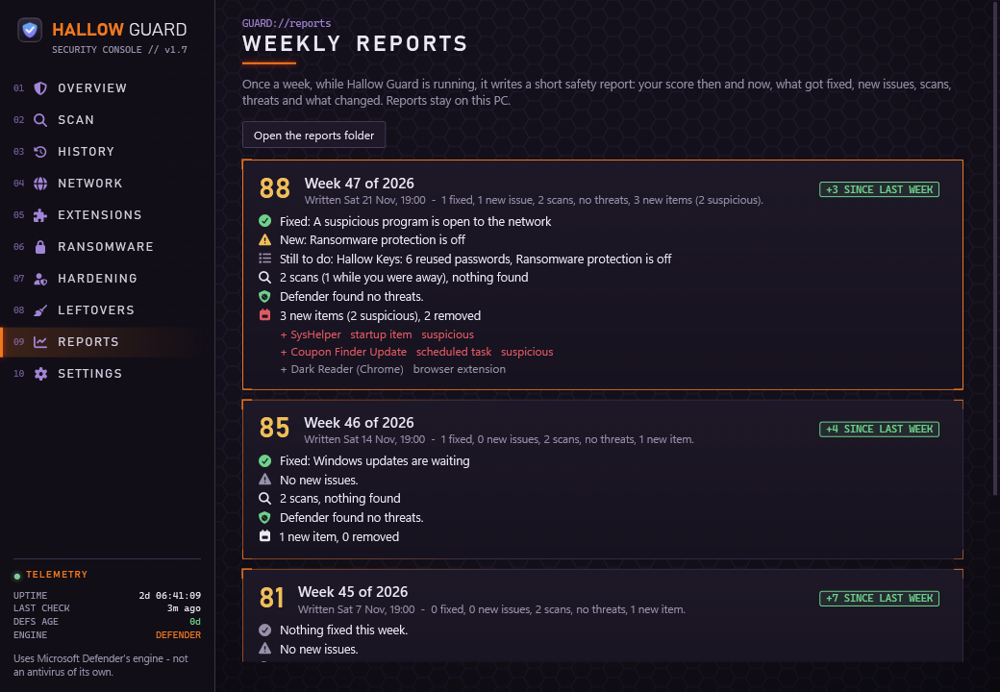

# Hallow Guard

**A friendly safety center on top of Microsoft Defender.**

Part of the Hallow family of Windows apps. Hallow Guard shows how well your PC is protected, in plain words, and asks
**Microsoft Defender** to scan when you want it to. It uses Defender's engine; it is **not an antivirus of its own**, and it
never disables, replaces or weakens Defender.



## What it does

- **One family safety score** (new in 1.1): the Overview's score covers the whole PC - the Windows checks below *and* the other
  Hallow apps - with one prioritised to-do list (the top 5 things worth the most points, each with a button) and two groups,
  **Windows** and **Hallow apps**, each with its own score. Every Hallow app is optional: one that isn't installed is shown as
  *Not installed* with a line on why it helps and a link, and **never costs points**. See [The family score](#the-family-score).
- **Safety score** (0-100) with a plain-English line per check: Defender's antivirus and real-time protection, how old the
  virus definitions are, the last quick/full scan, tamper protection, a third-party antivirus (then Defender is passive -
  and that's fine), Windows Firewall per network type, SmartScreen, Windows Update (last install, restart waiting),
  BitLocker on the Windows drive, User Account Control, Secure Boot and Memory integrity. Where it helps there's a button
  that opens the right Windows Security or Settings page - Hallow Guard **only reads** these settings.
- **Scans through Defender's engine** (`MpCmdRun.exe` from Defender's newest platform folder): quick, full, a folder you pick,
  or a file you drop on the window. Progress, cancel and the result.
- **Watch Downloads** (off by default): when a new file in your Downloads folder has finished (its size stays the same, and
  it isn't a `.crdownload` / `.part` / `.tmp` file), Defender scans just that file. You only hear from it if something is found.
- **History**: what Defender found - the threat, how serious, which file, when and what was done - explained in plain words.
  "Open in Windows Security" for restoring or removing.
- **Leftover hunt**, one click: startup entries (Run keys and Startup folders), scheduled tasks and services that aren't
  Microsoft's, programs running unsigned from Temp / AppData / Downloads, browser extensions (Chrome, Edge, Brave, Firefox)
  and hosts-file entries. Every row is **Known good** (signed by Microsoft or a well-known publisher, part of Windows, or a
  Hallow app), **Unknown** or **Suspicious** (unsigned, in Temp/AppData/Downloads *and* starting by itself), with the reason.
  Per row: open its location, scan it with Defender, look it up on VirusTotal - and for entries in your own startup list,
  **Disable**, which moves the entry to Hallow Guard's backup (`HKCU\Software\HallowGuard\DisabledStartup`) so **Restore**
  can put it back. Nothing is ever deleted.
- **VirusTotal second opinion** (optional): paste your own free API key in Settings (kept encrypted for your Windows
  account). A lookup sends **only the file's SHA-256** (`GET /api/v3/files/{sha256}`) - files are never uploaded. Without a
  key, "Look up" opens the file's VirusTotal page in your browser.
- **Hallow family**: the family pipe (`ping`, `status`, `open`, `menu`, `invoke`, `scan quick`, `report`, `quit`), `HallowGuard.exe
  --cmd "<line>"`, `%APPDATA%\HallowGuard\status.json` (score, last scan, threat count), notifications through Hallow Hub's
  icon when it runs, a weekly reminder when nothing was scanned for 7 days (on by default, never a scan by itself), the
  Hallow accent, crash reports kept on this PC, and updates from GitHub with a SHA-256 check.

## The family score



| Part | What Guard reads (read-only) | Points it can cost |
|---|---|---|
| **Windows** (the 12 checks) | Windows Security, the registry, WMI - as in 1.0 | the Windows score: 100 minus each check's points |
| **Hallow Keys** - password health | Only the counts Keys 2.8+ writes to its `status.json` (how many logins are weak, reused, leaked, on a breached site, missing 2FA the site offers - never a name, address or password). Guard never opens or reads the vault. Locked Keys reports the last counts with their age; counts older than 90 days aren't used. | leaked or breached 8, reused 5, weak 4, 2FA 2 - at most 12 |
| **Hallow Vault** - game save backups | Its `status.json` + pipe: last backup per game (switched-off games skipped), Vault's backup check, the second copy, running or not | failed checks 6, second copy unreachable 3, no backup / last one over 14 days old 3, not running 2 - at most 8 |
| **Hallow Shield** - ad & tracker blocker | Guard can't talk to a browser extension, so it looks for an extension named *Hallow Shield* in Chrome, Edge, Brave and Opera (GX) profiles: each profile's `Secure Preferences` / `Preferences` (the stored manifest, or the unpacked folder's `manifest.json`) and `Extensions\` - always by reading a **copy** in Guard's temp folder; locked or broken files are skipped. Per browser: installed or not, and its version. | switched off where installed 2 |
| **Hallow Assist** - remote help | Its `status.json`: unattended access on or off (no codes or secrets are in it). *On* is fine, but gets a line: "Unattended access is on - make sure its password is strong." | none |

- **Hallow apps score** = 100 minus the points above (shown as *-* when no Hallow app is installed).
- **Family score** (the big ring) = the Windows score minus the Hallow apps' points, **capped at 25** - so Windows always
  matters most, and an app you don't have never lowers it.
- Hallow Toolkit isn't part of the score: what it could add (Windows Update, startup clean-up) the Windows checks and the
  leftover hunt already cover.
- `status.json` keeps every 1.0 field (`score` is still the Windows score, for Hallow Hub's pill) and adds `familyScore`,
  `familyLabel`, `windowsScore`, `appsScore`, `todo` (how many to-dos) and `family` (each app: good / warn / bad /
  unknown / info / missing).

## Ransomware, network and extensions (new in 1.2)



- **Ransomware** page: Windows' *Controlled folder access* - off, on or audit mode, the folders you added and the apps you
  allowed (read from `MSFT_MpPreference`; when Windows only shows the lists to administrators, it says so). It explains
  what it does, lists folders worth protecting - Documents, Pictures and Desktop (Windows' own list), Saved Games, My Games
  and the game-save folders Hallow Vault lists in its `status.json`, if it lists any - and warns that it can stop games and
  apps from writing saves until you allow them. Every button opens `windowsdefender://ransomwareprotection/`; Guard never
  changes it. Off costs 3 points, audit mode 2.
- **Network** page: apps with connections right now (`GetExtendedTcpTable`), grouped by program, with how many hosts on the
  internet and on your local network; programs **open to the network** (TCP listening / UDP sockets not bound to loopback),
  each with its ports, signer and whether Windows Firewall lets it in on private and public networks (`HNetCfg.FwPolicy2`,
  read-only: block rules win, then allow rules for the program or port, then the default inbound action). Unsigned listeners
  running from Temp / AppData / Downloads are **Suspicious** (6 points). Countries aren't shown - that needs an online
  service and Guard sends nothing out; names (reverse DNS) are looked up only when you click **Look up names**. Buttons:
  open the file location, scan with Defender, open Windows Firewall.
- **Extensions** page: every extension in Chrome, Edge, Brave, Opera (GX) and Firefox profiles - manifests read with shared
  access, `Preferences` / `Secure Preferences` / `extensions.json` read from a copy, locked files skipped - rated **High**,
  **Medium**, **Low** or **Known** (Hallow Keys and Hallow Shield, which need every site to fill passwords and block ads),
  with the reasons: access to every site, sensitive permissions (debugger, proxy, nativeMessaging, webRequestBlocking,
  cookies, history, management, declarativeNetRequest with every site), not from the store (unpacked, sideloaded or by
  policy - `location` / `from_webstore`, Firefox's `foreignInstall`) and not updated for a year (the browser's date, else
  the extension folder's). Each high-risk extension that's switched on costs 3 points (at most 6). The only button opens
  that browser's extensions page.
- The network and extension checks form the **Network & browsers** group: at most 10 points off the family score, and on
  the to-do list. `status.json` adds `ransomware`, `moreScore`, `network` and `extensions` - counts only, never names,
  paths or addresses.

## Hardening checks (new in 1.6)



A **Hardening** page (in both looks) with read-only checks of the settings that make Windows harder to attack. Each one has
a plain-English line and a status code (`[OK]` / `[WARN]` / `[RISK]` / `[INFO]`). Buttons only open the right Windows
Security / Settings page, open Windows features, or show the steps - Hallow Guard never changes these settings.

- **Microsoft Defender settings** (MSFT_MpPreference): potentially unwanted app (PUA) blocking, cloud-delivered protection,
  automatic sample submission, network protection, and how many Attack Surface Reduction rules block / only watch. With
  another antivirus in charge these are one `[INFO]` line.
- **Defender exclusions**: every excluded path, file type and process. Malware often adds exclusions, so broad ones (a whole
  drive, %TEMP%, AppData, Downloads, your user folder, `.exe` / `.ps1`, wildcards) and ones that point inside Temp or at an
  unsigned program are a `[RISK]`. Windows only shows the lists to administrators: then **Check (admin)** reads them through
  UAC (like the BitLocker check - it only reads, into `exclusions.json` in Guard's data folder, trusted for 7 days).
- **Remote access**: Remote Desktop on/off and Network Level Authentication; remote-access apps (AnyDesk, TeamViewer,
  RustDesk, Chrome Remote Desktop, Splashtop, Parsec, ScreenConnect, LogMeIn, UltraViewer, VNC servers and more) installed or
  running, and whether they start with Windows or as an auto-start service (reachable unattended). Hallow Assist's unattended
  access stays in its own family check and is referenced here.
- **Old or risky features**: SMBv1 (Windows features, falling back to the registry), the PowerShell 2.0 engine, AutoPlay for
  USB drives (AutoRun never runs programs from USB on current Windows).
- **Accounts**: local accounts Windows marks as not needing a password, Guest on, more than one administrator in use, and you
  as administrator with UAC on "never notify".
- **Wi-Fi**: saved networks that are open and connect by themselves, and the security type of the network you're on. netsh is
  only asked `wlan show profiles`, `wlan show profile name=...` and `wlan show interfaces` - **never `key=clear`**, so Wi-Fi
  passwords are never read, shown or logged (a guard refuses any `key=` argument).
- They form the **Hardening** group: its own score, at most 10 points off the family score (lightly: 1-4 points per item),
  and the to-do list. `status.json` adds `hardeningScore` only.

## The Hallow console look (1.4, in the Hallow colours since 1.7)



1.7 repaints the 1.4 security-console look in the Hallow family's colours, so Guard sits next to Mixer, Hub, Assist and the
rest as one family - same layout, same motion:



- **A security console in the Hallow palette**: the family's dark purple-black backgrounds, corner brackets on every card,
  a faint lilac hex grid and a vignette. The glow - borders, the radar sweep, the open page's bar, focus - is your **Hallow
  accent** (orange unless you picked another in Hallow Toolkit; it follows `theme.json` live, like the other apps, when
  *Use the Hallow accent* is on). Lilac for secondary lines and codes; the family's green, amber and red for secure, warning
  and threat. Headings in spaced capitals (Bahnschrift),
  numbers, IDs, paths and logs in a monospace font (Cascadia Mono, or Consolas when it isn't installed).
- **Overview**: the score is a radar ring - a segmented arc with tick marks that counts up when it appears, a sweep line
  while the checks run and a slow pulsing glow when the PC is secure - with a `STATUS: SECURE / ATTENTION / AT RISK`
  readout and the three groups as segmented bars. Every check is a row with a status LED and a code: `[OK]`, `[WARN]`,
  `[RISK]`, `[INFO]`, `[UNK]`, `[N/A]` - nothing is told by colour alone.
- **Scan**: a big elapsed timer, a scanning beam over scanlines and a terminal-style console with timestamps: the exact
  `MpCmdRun` command, everything it prints, and a heartbeat each minute while it still runs (Defender gives no percentage).
- **History and Leftovers**: tags like `SEV:SEVERE`, Defender's threat ID in hex, Guard's scrambled ID for each leftover,
  and a pulsing red edge on suspicious items. **Network**: a connection map - this PC in the middle, the apps around it with
  their internet and local hosts, suspicious ones in red - above the same list as before.
- **Sidebar**: numbered pages with a glowing accent bar on the open one, icons that glow on hover, and a small telemetry block (PC
  uptime, last check, definitions age, engine).
- **Cheap on purpose**: animations run at 24 frames a second and only while the window is visible, not minimized and in
  front. They stop in the tray, while a game or full-screen app runs (the same check as the scan while you're away) and when
  Windows' *Show animations* is off - then every animated part shows a still frame.
- **Keyboard focus** is a glowing outline; text contrast is at least 4.5:1 with any accent - a very dark accent is lightened
  for the glow (checked by the tests).
- **Settings > Look**: *Hallow console* (the default), *Hallow classic* - the 1.3 look, untouched - or *Cyber blue*, the 1.4
  neon-cyan console for whoever liked it. A look saved by 1.4-1.6 as "Cyber" (the default then) opens as Hallow console;
  Hallow classic stays Hallow classic.



## Scans while you're away, weekly reports, what changed (new in 1.3)



- **Run a quick scan when I'm away** (Settings, **off by default**, daily or weekly): when nobody has touched the mouse or
  keyboard for 10 minutes (`GetLastInputInfo`), no game or full-screen app is running (Delta Force and the other known game
  processes, Windows' "full-screen / busy" state, and the games Hallow Hub says are being played), the PC is plugged in
  (`GetSystemPowerStatus`) and there's been no quick or full scan (Guard's or Defender's own) for a day or a week, Guard
  asks Defender for a quick scan with `MpCmdRun` at the lowest (Idle) priority. It checks every 5 seconds while it runs and
  stops it (`-Cancel`) as soon as you come back, a game starts or the PC is unplugged, then waits at least an hour before
  trying again. You only hear from it if something is found. Game controllers don't count as input for Windows - that's why
  a running game or full-screen app is checked separately. Defender's engine keeps its own CPU limit (Guard never changes it).
- It needs Hallow Guard running in the tray. **Start with Windows** is off by default, so either open Guard after you sign in
  or turn Start with Windows on - Settings says so when the scan is on and Start with Windows is off.
- **Weekly safety report**: once a week while Guard runs (after the checks, and after a fresh low-priority look at the
  leftovers - never while a game runs) it writes `%APPDATA%\HallowGuard\reports\<yyyy-ww>.json` (ISO week) and a short text
  summary `<yyyy-ww>.txt`: the score then and now, what got fixed, new issues, what's still to do, scans (how many while you
  were away), threats Defender found that week and what changed. The **Reports** page shows past weeks. One balloon - *"Your
  weekly safety report: 88 (+3)"* - goes through Hallow Hub's icon only when Hub is running with its icon showing, Windows
  notifications are on and *Tell me when the weekly safety report is ready* is on (default); never twice in a week and never
  during a game.
- **What changed since last week**: after each leftover hunt Guard keeps a small snapshot
  (`%APPDATA%\HallowGuard\snapshots\<yyyy-ww>.json`, the 8 newest) of startup items, scheduled tasks, services, browser
  extensions and programs open to the network - a 16-digit SHA-256 ID of what each one runs, its short name (your user folder
  taken out) and whether it was suspicious. **No paths and no file contents.** The Leftovers page shows what's new and what's
  gone since the newest snapshot of an earlier week and marks new rows; the report lists them too. A **new suspicious** item
  goes to the top of the to-do list (it costs no points - it asks you to look).
- Family link: the pipe adds `report` (the newest report), `report <yyyy-ww>` and `report list`; `status.json` adds
  `lastReport` (week, score, previous score, delta, how many fixed / new issues / scans / threats / new and removed items -
  counts only, no names), `changes` (counts), `awayScan`, `awayEvery` and `lastAwayScan`. Every older field is unchanged.

## What it won't do (on purpose)

- It never switches Defender off or changes its settings, and never changes a security setting by itself. The two
  admin actions - reading whether BitLocker is on, and reading Defender's exclusions, when Windows only tells
  administrators - run only when you click "Check (admin)", Windows asks you first, and they only read.
- It never reads Wi-Fi passwords (netsh is never asked with `key=clear`).
- It never deletes files. Defender decides what happens to threats; you manage them in Windows Security.
- It never opens your Hallow Keys vault, never changes a browser file and never starts a Hallow app unless you click its button.
- It never uploads files anywhere. Nothing leaves the PC except a file's fingerprint to VirusTotal, when you ask, with your key.

## Install

Download **Hallow Guard.zip** from the [latest release](https://github.com/Dom428/hallow-guard/releases/latest), unblock and
extract it, and run `INSTALL.bat` (no admin needed). It installs to `%LOCALAPPDATA%\Programs\Hallow Guard` with Start menu
and Desktop shortcuts. Settings > *Start with Windows* (off by default) keeps it in the tray for Watch Downloads, the scan
while you're away, the weekly report and the weekly reminder.

## Build

```
.\build.ps1          # HallowGuard.exe with the C# compiler that ships with Windows (.NET Framework 4.8)
.\build.ps1 -Tests   # also tests\GuardTests.exe
.\tests\GuardTests.exe
.\HallowGuard.exe --snap <folder>   # every page rendered off-screen with made-up data (Hallow console; classic\ and cyberblue\ subfolders)
```

The tests never run a real Defender scan: they use a stand-in `MpCmdRun`, made-up system checks, a local stand-in for
VirusTotal and fake registry keys of their own. The family tests use fake `status.json` files for every app state (missing,
running, stopped, stale) and fake browser profile folders (locked and broken files included). The 1.2 tests use a fake
Controlled folder access state, fake TCP/UDP table bytes and firewall rules, and fake Chrome / Edge / Opera / Firefox
profiles with manifests and Preferences (and check the browser files are byte-for-byte unchanged).
`tests\GuardTests.exe --real-timing` runs the real read-only 1.2 checks once and prints only timings and counts.
The 1.3 tests use a fake clock, fake idle time, power and "game running", the stand-in `MpCmdRun` (which reports the
priority it was given), fake leftovers / listeners / last week's snapshot and report, and a fake Hallow Hub on the test pipe
that records the balloon - the scan while you're away is never started for real in a test.
The 1.6 tests use a fake MSFT_MpPreference, a fake registry (Remote Desktop, services, uninstall entries, Run keys,
AutoPlay, SMBv1), fake netsh output (and check that no netsh call ever contains `key=clear`), fake accounts, a fake process
list and fake Windows features. `tests\GuardTests.exe --real-hardening` runs the real read-only hardening checks once and
prints only timings, check IDs and states.

## What's new

- **1.7** - Guard looks like a Hallow app again: the console look is repainted in the family's dark purple-black with the
  Hallow accent as its glow (following Hallow Toolkit's accent live), lilac secondary lines and the family's green / amber /
  red. Same radar, brackets, codes, scan console, hex grid, telemetry and motion. Looks: *Hallow console* (default), *Hallow
  classic*, *Cyber blue* (the 1.4 cyan). A saved "Cyber" becomes Hallow console. Nothing else changed.
- **1.6** - Windows hardening checks: a Hardening page (both looks) for Defender's settings (PUA, cloud protection, sample
  submission, network protection, ASR rules), Defender exclusions (broad or Temp / unsigned ones flagged; "Check (admin)" when
  Windows hides them), remote access (Remote Desktop + NLA, remote-access apps that start with Windows or run unattended),
  old features (SMBv1, PowerShell 2.0, AutoPlay), accounts (no password, Guest, several admins, admin with UAC off) and Wi-Fi
  (open networks that auto-connect, the current network's security - never a password). Read-only, lightly in the score
  (at most 10), on the to-do list.
- **1.5** - New app icon: a blue-to-purple shield with a check, in the Hallow family style (Hallow Shield, the browser
  extension, has the orange shield with a "blocked" mark). Nothing else changed.
- **1.4** - the cyber look: a security-console design with a radar score ring, `[OK]` / `[WARN]` / `[RISK]` status rows,
  a live scan console with timer and scanning beam, threat tags, a network connection map and a telemetry sidebar. Calm and
  cheap: animations only while the window is in front, never during a game or full-screen app, and not when Windows'
  animations are off. Settings > Look switches back to *Hallow classic* (the 1.3 look). Nothing else changed.
- **1.3** - a quick scan while you're away (off by default: idle 10 minutes, no game, plugged in, low priority, stops when
  you come back), a weekly safety report (score then vs now, fixed, new issues, scans, threats; a Reports page, the `report`
  pipe command and `lastReport` in `status.json`, one balloon through Hallow Hub) and "what changed since last week" for the
  leftovers (new and removed items, new suspicious ones first on the to-do list).
- **1.2** - ransomware protection (Controlled folder access, read-only, with folders worth protecting and the game-save
  warning), a network view (apps connected right now, programs open to the network with signer and firewall answer,
  suspicious unsigned listeners) and browser extension risk (High / Medium / Low / Known with reasons) - new pages, and
  a *Network & browsers* group in the family score and to-do list.
- **1.1** - one family safety score: the Overview covers Windows *and* the Hallow apps (Keys' password-health counts,
  Vault's backups, Shield in your browsers, Assist's unattended access), one to-do list, a score per group; `familyScore` in
  `status.json`.
- **1.0** - first version: safety score, scans through Defender's engine, Watch Downloads, threat history, leftover hunt,
  VirusTotal hash lookups, Hallow family link.

Icons: [Font Awesome Free](https://fontawesome.com) 7.3.1 by Fonticons, Inc., CC BY 4.0 (see FontAwesome-LICENSE.txt).
